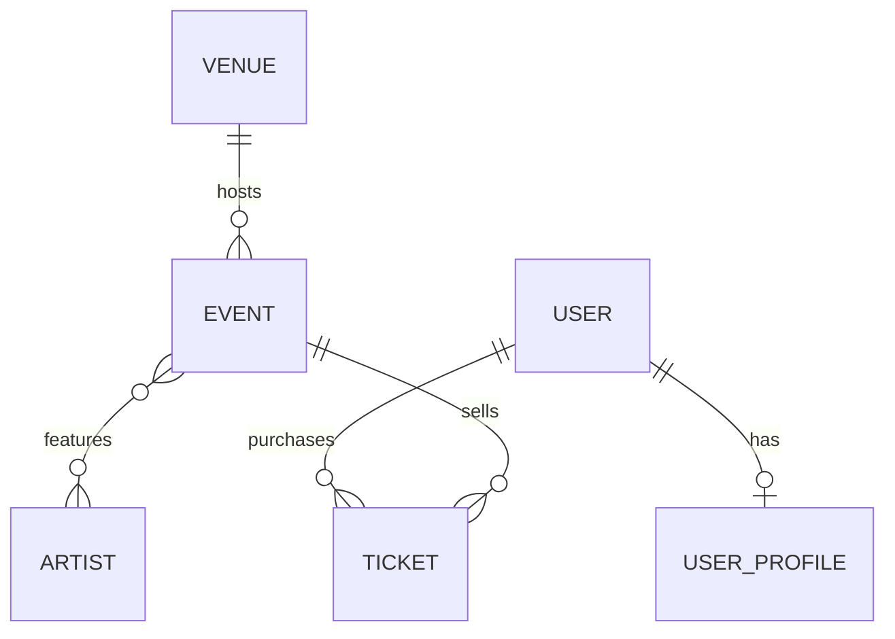

Taller de PulsePass
Proyecto académico (persistencia, servicios y API REST) de una plataforma de eventos, artistas y entradas.
Incluye el modelo relacional, las migraciones con Flyway, las entidades JPA, los repositories de
Spring Data y las pruebas de integración contra un PostgreSQL real.

Miembros del grupo: 
-Juan Arias
-Martin Soto 
Grupo: 3

Se utilizó:

- Java 21
- Spring Boot 4 con Spring Data JPA (Hibernate)
- PostgreSQL 16
- Flyway para versionar el esquema
- Testcontainers para las pruebas
- Maven

Requisitos para ejecutar 

- JDK 21
- Maven 3.9 o superior
- Docker en ejecución (lo necesitan las pruebas, porque Testcontainers levanta PostgreSQL solo)
No hace falta instalar PostgreSQL

Cómo ejecutar

Correr las pruebas:

```bash
mvn clean test
```

Correr la aplicación con una base de datos local (opcional):

```bash
docker compose up -d
mvn spring-boot:run
```

Al arrancar, Flyway crea las tablas y Hibernate solo las valida (ddl-auto=validate).

Las pruebas no usan H2 ni la base del docker-compose.yml. Cada ejecución levanta un contenedor postgres:16-alpine nuevo.

Estructura del proyecto

```
src/main/java/com/pulsepass
├── PulsePassApplication.java
├── domain
│   ├── enums        EventCategory, EventStatus, TicketType, TicketStatus
│   └── model        Venue, Event, Artist, User, UserProfile, Ticket
└── repository       un repository por entidad

src/main/resources
├── application.yml
└── db/migration     V1, V2, V3 y V4

src/test/java/com/pulsepass
├── support          PostgresContainerConfig, AbstractPostgresIT, TestData
├── migration        FlywayMigrationIT
└── repository       VenuePersistenceTest, EventRepositoryIT, EventArtistIT,
                     UserProfileIT, TicketRepositoryIT, EventSearchIT
```

Modelo de datos



| Relación | Cómo la mapeamos |
|---|---|
| Venue 1:N Event | @ManyToOne en Event.venue (FK venue_id). Venue.events es el lado inverso con mappedBy. |
| Event N:M Artist | @ManyToMany con la tabla event_artists, que tiene PK compuesta (event_id, artist_id). Usamos Set para no repetir artistas. |
| User 1:1 UserProfile | La FK user_id de user_profiles es UNIQUE. Un usuario puede no tener perfil (BR-004 dice "como máximo uno"). |
| User 1:N Ticket y Event 1:N Ticket | Ticket tiene dos @ManyToOne (user_id y event_id), ambas NOT NULL. |

Decisiones que tomamos:

- Ticket es una entidad y no un @ManyToMany entre User y Event porque tiene datos propios
  (código, tipo, precio, estado y fecha de compra).
- Los enums se guardan con EnumType.STRING. Con ORDINAL, cambiar el orden del enum dañaría los datos ya guardados. Además cada columna tiene un CHECK con los valores permitidos.
- El precio es BigDecimal en Java y NUMERIC(12,2) en la base, para evitar errores de redondeo.
- equals y hashCode usan la clave de negocio (code, eventCode, stageName, etc.) porque el
  id es null hasta que se guarda.
- No usamos Lombok en las entidades.
- La tabla se llama users porque user es palabra reservada en PostgreSQL.

## Migraciones

| Archivo | Qué hace |
|---|---|
| V1__create_schema.sql | Crea las 7 tablas con sus PK, FK, UNIQUE, CHECK e índices. |
| V2__insert_initial_artists.sql | Inserta a Solar Beat, Neon Waves, Caribbean Sound, Ocean Drive y Digital Pulse. |
| V3__add_streaming_url_to_event.sql | Agrega streaming_url VARCHAR(500) (nullable) a events. |
| V4__security_credentials_roles.sql | Agrega `user_credentials` (hash BCrypt) y `user_roles` (USER, STAFF, ADMIN) para la fase de seguridad. |

Restricciones que aplica PostgreSQL:

| Regla | Restricción |
|---|---|
| Códigos e identidades únicos | uq_venues_code, uq_events_event_code, uq_artists_stage_name, uq_users_username, uq_users_email, uq_tickets_ticket_code |
| Capacidad mayor que 0 | ck_venues_capacity |
| Precio mayor o igual a 0 | ck_tickets_price |
| Estados, categorías y tipos válidos | ck_events_category, ck_events_status, ck_tickets_type, ck_tickets_status |
| Un solo perfil por usuario | uq_user_profiles_user |
| Sin pares evento-artista repetidos | PK compuesta en event_artists |
| Ticket con usuario y evento reales | FK y NOT NULL en user_id y event_id |

Una migración que ya se aplicó no se edita. Los cambios nuevos van en una versión nueva (V5, V6...).

 Consultas

| Necesidad | Método | Tipo |
|---|---|---|
| Evento por eventCode | findByEventCode | Query Method |
| Eventos publicados por fecha | findByStatusOrderByEventDateAsc | Query Method |
| Eventos de un venue por código | findByVenueCode | Query Method (navega venue.code) |
| Usuario por email sin importar mayúsculas | findByEmailIgnoreCase | Query Method |
| Tickets de un usuario por email y estado | findByUserEmailIgnoreCaseAndStatus | Query Method |
| Tickets PAID de un evento | findByEventEventCodeAndStatus | Query Method |
| Eventos por artista | findByArtistStageName | JPQL con JOIN |
| Eventos por ciudad y artista | findByCityAndArtist | JPQL con JOIN |
| Eventos recomendados | findRecommended | JPQL con DISTINCT y ORDER BY |
| Cantidad de tickets PAID | countPaidByEventCode | JPQL con COUNT |
| Tickets de eventos futuros | findForEventsAfter | JPQL con JOIN y ORDER BY |

Usamos Query Method cuando el nombre del método alcanza para entender la consulta. Usamos JPQL
cuando hay JOIN explícito, DISTINCT, COUNT o varias relaciones. No usamos SQL nativo.

Para los tickets PAID de un evento elegimos Query Method porque son solo dos condiciones de igualdad.

Pruebas

| Clase | Qué prueba |
|---|---|
| FlywayMigrationIT | Que las migraciones (V1–V4) se apliquen desde una base vacía y que Hibernate solo valide. |
| VenuePersistenceTest | Venue: guardar, código único, capacidad válida y relación con eventos. |
| EventRepositoryIT` | Eventos: consulta por código, por venue, publicados en orden, enums y streaming_url. |
| EventArtistIT | Relación N:M, artistas repetidos y consulta por artista. |
| UserProfileIT | Relación 1:1, username y email únicos, segundo perfil rechazado. |
| TicketRepositoryIT | Tickets: relaciones, código único, precio, consultas y conteo de PAID. |
| EventSearchIT | Búsquedas por ciudad, artista y eventos recomendados. |

Cómo están hechas:

- Todas usan PostgreSQL real con un solo contenedor compartido (PostgresContainerConfig).
- Cada prueba corre en una transacción que se revierte al final.
- Antes de leer se llama a flushAndClear() para que los datos vengan de la base y no de la memoria
  de JPA.
- Las violaciones de restricciones van al final de cada prueba, porque PostgreSQL cancela la
  transacción después del primer error.

Respuestas a Preguntas

1. ¿Por qué Ticket es una entidad y no un
@ManyToMany?
Porque tiene atributos propios (código, tipo, precio, estado y fecha). Un @ManyToMany solo guarda
el par de ids y no puede llevarlos.

2. ¿Qué reglas van en PostgreSQL y cuáles en una capa Service?
En la base van las que nunca se pueden romper: unicidad, claves foráneas, NOT NULL, rangos y
catálogos. En un Service irían las que dependen de más contexto, como las transiciones de estado o
calcular cuándo un evento está SOLD_OUT.

3. ¿Qué consultas son Query Methods y cuáles JPQL?
Query Method para filtros simples o que navegan una relación. JPQL cuando hay JOIN, DISTINCT, COUNT o varias relaciones a la vez.

4. ¿Qué pasa si se modifica V1 después de aplicarla?
Flyway guarda un checksum de cada migración y falla al arrancar si el archivo cambió. Lo correcto
es crear una migración nueva.

5. ¿Qué diferencias podría ocultar H2?
H2 se comporta distinto a PostgreSQL en tipos, IDENTITY, CHECK y en los mensajes de error. Una
prueba puede pasar en H2 y fallar en PostgreSQL.

6. ¿Cómo evolucionaría el modelo para evitar sobreventa?
Con una tabla de inventario, por ejemplo TicketInventory(event, type, total, sold), que se
actualice en la misma transacción que crea el ticket, con bloqueo optimista (@Version) o un
UPDATE condicionado. También separando Order y Payment de Ticket.


Capa de servicios (fase 2)

Implementa el PRD "Capa de Servicios": interfaces `*Service`, implementaciones `@Service`, DTOs `record`,
mappers MapStruct, excepciones de dominio y reglas de negocio (BR-*) con transacciones.

```
src/main/java/com/pulsepass
├── config       ClockConfig (Clock inyectable para reglas basadas en "ahora")
├── dto
│   ├── request  CreateEventRequest, RegisterUserRequest, PurchaseTicketRequest
│   └── response VenueResponse, ArtistResponse, EventResponse, EventSummaryResponse, UserResponse, TicketResponse
├── mapper       VenueMapper, ArtistMapper, EventMapper, UserMapper, TicketMapper (MapStruct)
├── exception    ResourceNotFoundException, DuplicateResourceException, BusinessRuleException
└── service
    ├── VenueService, ArtistService, EventService, UserService, TicketService
    ├── TicketPricingPolicy   precio por tipo de ticket (GENERAL x1, STUDENT x0.5, VIP x2.5, BACKSTAGE x4)
    ├── TicketCodeGenerator   códigos únicos de ticket
    └── impl                  implementaciones (constructor injection, @Transactional)
```

Estrategia de precio: el cliente nunca envía el precio. El precio base se configura con
`pulsepass.pricing.base-price` (por defecto 100.00) y se multiplica según el `TicketType`.

Los unit tests de Service (`src/test/java/com/pulsepass/service`, `.../mapper`) usan JUnit 5, Mockito y AssertJ,
sin Spring ni PostgreSQL. Se ejecutan con `mvn clean test` junto con los tests de integración existentes.


Capa de controladores REST (fase 3)

Implementa el PRD "Capa de Controladores REST": los casos de uso de los Services se exponen por HTTP
sin duplicar reglas de negocio, sin tocar Repository y sin devolver entidades JPA.

```
src/main/java/com/pulsepass
├── controller   VenueController, EventController, ArtistController, UserController, TicketController
├── dto
│   ├── request  CreateEventRequest, RegisterUserRequest, PurchaseTicketRequest (con Bean Validation)
│   └── response ... + ErrorResponse
└── exception    ... + GlobalExceptionHandler (@RestControllerAdvice)
```

Endpoints principales (20 operaciones, una por cada método público de los Services):

| Método | Endpoint | Éxito |
|---|---|---|
| GET | /api/venues/{code} · /api/venues/active | 200 |
| POST | /api/events | 201 |
| GET | /api/events/{eventCode} · /api/events/published · /api/events/by-artist?stageName= | 200 |
| PATCH | /api/events/{eventCode}/publish | 200 |
| POST | /api/events/{eventCode}/artists/{artistId} | 200 |
| GET | /api/artists/{id} · /api/artists/by-stage-name?stageName= · /api/artists/active | 200 |
| POST | /api/users | 201 |
| GET | /api/users/by-email?email= · /api/users/by-username?username= | 200 |
| POST | /api/tickets | 201 |
| GET | /api/tickets/{ticketCode} · /api/tickets/by-user?email= · /api/events/{eventCode}/tickets/paid | 200 |
| PATCH | /api/tickets/{ticketCode}/cancel · /api/tickets/{ticketCode}/use | 200 |

Errores (todos con el cuerpo `ErrorResponse`: timestamp, status, error, message, details):

| Condición | HTTP |
|---|---|
| Bean Validation, JSON mal formado, parámetro faltante o de tipo inválido | 400 |
| ResourceNotFoundException | 404 |
| DuplicateResourceException, BusinessRuleException | 409 |
| Excepción inesperada (mensaje genérico, sin stack trace) | 500 |

Pruebas de controller (`src/test/java/com/pulsepass/controller`): usan `@WebMvcTest`, `MockMvc` y
`@MockitoBean` para los Services, así que no necesitan PostgreSQL ni Docker. Verifican status,
Content-Type, JSON con `jsonPath`, la interacción con el Service (`verify`) y que un request
inválido nunca lo invoca (`verify(..., never())`).

```bash
mvn clean test                                   # todo el proyecto
mvn test -Dtest='*ControllerTest,ControllerLayerDesignTest,GlobalExceptionHandlerTest'   # solo la fase 3
```


Capa de seguridad (fase 4 — Estado Final Completo)

Implementa de forma completa el PRD "Capa de Seguridad con Spring Security y JJWT":
contrato de autorización, persistencia de credenciales y roles, contraseñas con BCrypt, login con emisión y validación de JWT, filtro de seguridad Bearer (`JwtAuthenticationFilter`), servicio de autorización con anti-IDOR (`AuthorizationService`), control de roles y visibilidad de eventos no publicados.

| Componente / Etapa | Descripción | Ubicación |
|---|---|---|
| 1. Contrato & Matriz | Matriz de autorización de las 20 rutas + auth | `PRD_PulsePass_Capa_Seguridad_Spring_Security_JJWT.md` y `tests/e2e/inventario-etapa1.md` |
| 2. Persistencia Flyway | Migración `V4__security_credentials_roles.sql`, tablas `user_credentials` y `user_roles` | `src/main/resources/db/migration/` |
| 3. Autenticación & Passwords | Hashing BCrypt, `SecurityPrincipal`, `CustomUserDetailsService` | `src/main/java/com/pulsepass/security/` |
| 4. JWT & Filtros | Emisión y validación con JJWT 0.13.0, `JwtAuthenticationFilter` (Bearer token) | `src/main/java/com/pulsepass/security/` |
| 5. Autorización & Anti-IDOR | `AuthorizationService` para verificar propiedad de recursos y filtrar eventos no publicados en `GET /api/events/by-artist` y `GET /api/events/{code}` | `src/main/java/com/pulsepass/security/` |
| 6. Pruebas de integración | Pruebas de integración de seguridad con JWT reales firmados | `src/test/java/com/pulsepass/security/SecurityJwtIntegrationTest.java` |

Variables de entorno (ver `.env.example`; no versionar el secreto en producción):

```bash
export PULSEPASS_JWT_SECRET_BASE64=$(openssl rand -base64 32)   # obligatoria: sin ella la app no arranca
export PULSEPASS_JWT_ISSUER=pulsepass-api                       # opcional
```

Operaciones y Reglas de Seguridad:

- `POST /api/users`: Público. Registro atómico de usuario con contraseña (12-72 caracteres) y asignación automática de `ROLE_USER`.
- `POST /api/auth/login`: Público. Recibe `{identifier, password}` y emite JWT firmado HS256 con vencimiento de 15 minutos.
- `GET /api/auth/me`: Autenticado (Bearer token). Retorna los datos del principal autenticado.
- `POST /api/tickets`: Requiere `ROLE_USER`. Valida estrictamente que `userEmail` coincida con la identidad del principal autenticado (anti-IDOR).
- `GET /api/events/by-artist`: Público para eventos `PUBLISHED`. Eventos en borrador u otros estados requieren `ROLE_STAFF` o `ROLE_ADMIN`.
- `GET /api/events/{eventCode}`: Público para eventos `PUBLISHED`. Si no está publicado, exige `ROLE_STAFF` o `ROLE_ADMIN`.
- Errores de seguridad (401 Unauthorized, 403 Forbidden) mantienen el contrato estandarizado `ErrorResponse`.

Comandos de prueba:

```bash
# Ejecutar todas las suites de unit tests, MockMvc y pruebas de integración JWT:
mvn test -Dtest=JwtServiceTest,AuthServiceImplTest,UserServiceImplTest,TicketServiceImplTest,VenueArtistServicesTest,EventServiceImplTest,VenueControllerTest,ControllerLayerDesignTest,GlobalExceptionHandlerTest,UserControllerTest,SecurityRulesTest,TicketControllerTest,AuthControllerTest,EventControllerTest,ArtistControllerTest,CustomUserDetailsServiceTest,AuthorizationServiceTest,MappersTest,ServiceLayerDesignTest,TicketPricingPolicyTest,SecurityJwtIntegrationTest
```


Pruebas E2E manuales con Postman (fase 5)

Verifica la API real (Spring Boot + Spring Security + PostgreSQL) desde un cliente HTTP, sin mocks y sin scripts de Postman:
cada petición se envía a mano con **Send** y se compara con el resultado esperado. Todo vive en `tests/e2e/` (la carpeta
`postman/` de la raíz es el espejo de la misma colección en el formato de Postman con Git).

| Qué | Dónde |
|---|---|
| Guía paso a paso (base, app, Postman, tokens, SQL, cierre) | `tests/e2e/README.md` |
| Colección v2.1 (22 rutas, 108 casos base, Flujos A–E) y ambiente | `tests/e2e/postman/` |
| Orden de ejecución con casillas | `tests/e2e/checklist-e2e-manual.md` |
| Bitácora, consolidación y acta de cierre | `tests/e2e/registro-ejecucion-manual.md` |
| Cobertura ruta → casos, roles y trazabilidad al PRD | `tests/e2e/matriz-cobertura.md` |
| Datos de prueba y scripts SQL (solo base `pulsepass_e2e`) | `tests/e2e/fixtures/` |
| Inventario de rutas contra el código real | `tests/e2e/inventario-etapa1.md` |

Resumen de arranque (detalle en `tests/e2e/README.md`):

```bash
docker compose up -d
docker compose exec postgres psql -U pulsepass -c "CREATE DATABASE pulsepass_e2e;"
export DB_URL=jdbc:postgresql://localhost:5432/pulsepass_e2e
export PULSEPASS_JWT_SECRET_BASE64=$(openssl rand -base64 32)
mvn spring-boot:run          # otra terminal: aplicar tests/e2e/fixtures/seed-e2e.sql
```

Los resultados reales se anotan en la bitácora; la colección por sí sola no demuestra que la API funcione.
